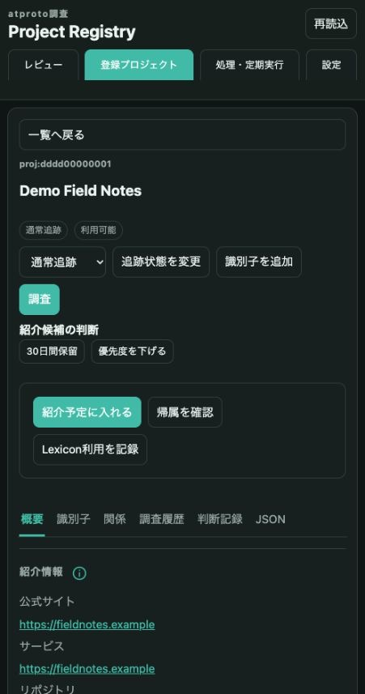

# atproto survey automation

**気になるatprotoプロジェクトを集め、根拠を読み、次に深掘りする対象を選ぶためのローカル調査ツールです。** Web UIとCLIから同じSQLite DBを使い、サービス、ライブラリ、Lexiconの調査結果と自分の判断を蓄積します。

たとえば、新しいLexiconを見つけたら、そのNSIDを登録して調査します。関連するリポジトリやサービス、用途の説明、atprotoとの関係を確認し、曖昧な帰属は根拠を見て採用・保留します。紹介候補の一覧から気になる対象を選び、追加調査や短い紹介文の下調べに使えます。

| すること | 得られるもの |
| --- | --- |
| URLやNSIDを登録する／外部情報源から候補を集める | 同じ対象のシードと関連情報をまとめた登録プロジェクト |
| 登録した対象を調査する | 説明・分類、サービスやLexiconの情報、取得元と調査履歴 |
| 根拠を確認して整理する | 採用・除外・保留などの手動判断、重複の整理、紹介状況 |
| 紹介候補を見直す | 深掘りする対象と、確認・訂正が必要な点 |

PC表示では、登録プロジェクトの一覧と選択したプロジェクトの詳細を並べて確認できます。詳細から説明、識別子、関係、調査履歴、手動判断をたどれます。下の画面は同梱の架空データを表示したものです。



調査と候補提示は判断の補助です。生成された説明や帰属には誤りがあり得るため、根拠を確認して人が紹介可否を決めます。紹介文の公開はツールの外で行います。

手動で深掘りする時は[atprotoの活用事例を調べる](docs/user/research-methods.md)を参照してください。情報源の選び方、帰属の照合、機能とデータの対応、変化の確認を説明しています。

## 動作環境

動作確認済みの環境はmacOS（Apple Silicon）です。Linux・Windowsでの動作は未検証です。macOSへのログイン時にWebを自動起動する`project-registry-web-service`はmacOS専用です。

## 架空データで試用デモを動かす

[uv](https://docs.astral.sh/uv/getting-started/installation/)とNode.js 22.15以上を用意し、リポジトリのルートで実行します。Python本体と依存の取得にはネットワーク接続が必要です。サンプルの生成・閲覧には外部APIキーやLLMは不要です。

```bash
bin/project-registry-python-env prepare initial
bin/project-registry-python-env activate initial
npm install
bin/project-registry dev-db
bin/project-registry-web --host 127.0.0.1 --port 8765 --db-path data/dev/survey.db --token web-ui-dev
```

[ローカル画面](http://127.0.0.1:8765/)を開き、ログイン用トークンとして`web-ui-dev`を入力します。これはWebの起動時に`--token`で指定した値です。デモには架空の5件と調査済みの結果が用意されており、次の2つを試せます。

1. `登録プロジェクト`→`Demo Field Notes`で一覧と詳細を開き、説明と判断欄を見る。
2. `登録プロジェクト`→`Demo Sketch Board`→`調査履歴`で部分失敗を見る。`調査履歴を読み込む`から記録を選ぶと、保存済みの根拠も開ける。

このデモは保存済みの調査結果を閲覧・編集するためのものです。`調査`ボタンは実際に外部へアクセスするため、架空データでは使わず、実際の対象を登録した後に試してください。

試用を終える時はターミナルでCtrl+Cを押します。サンプルは`data/dev/survey.db`に保持されます。既に環境やサンプルがある場合は生成を繰り返さず、Webの起動から再開してください。

**自分の対象を調べるには、[利用ガイド](docs/user/guide.md#自分の調査dbを用意する)へ進みます。** 自分用のDB、LLMと情報源の設定、1件の登録・調査から継続利用までを案内します。

## 必要な文書を探す

| 知りたいこと | 文書 |
| --- | --- |
| 導入して一通り使いたい | [利用ガイド](docs/user/guide.md) |
| 画面の操作／コマンドの引数と副作用を確認したい | [Web UI](docs/user/web-ui.md)・[CLI](docs/user/cli.md) |
| LLMや認証、収集対象を設定したい | [接続設定](docs/user/configuration.md) |
| Pythonを更新・復旧したい | [Python環境の管理](docs/user/python-environment.md) |
| 目的と開発上の残件を知りたい | [Brief](docs/brief.md)・[TODO](docs/developer/todo.md) |
| 実装の構成と機能の契約を知りたい | [Architecture](docs/developer/architecture.md)・[仕様一覧](docs/documentation-policy.md#開発仕様) |
| 開発・文書保守に参加したい | [AGENTS](AGENTS.md)・[文書管理方針](docs/documentation-policy.md)・[変更の受入](docs/developer/workflows/change-acceptance.md) |
| 通常処理と独立した手動ツールを使いたい | [補助ツール](extras/README.md) |

開発時の全unit testは`bin/project-registry-test`です。外部API、正本DB、実LLMへ接続せず、一時DBで実行します。

## 利用と共有の範囲

個人が自分のローカルDBを運用するためのツールです。複数利用者の共有DBや公開Webサービスとしての運用、外部向けAPIの互換性保証は提供しません。通常の調査DBは`data/survey.db`です。

調査DB、認証情報を設定する`.envrc`、実行ログ、非公開のLLM事例はGit管理外です。DBの共有には用途に合わせた論理exportと、収集資料に含まれる認証値などの確認が必要です。共有用の秘匿処理付きDB exportは未実装です。

本体コード・文書は[MIT License](LICENSE)、第三者の同梱データや引用は[個別の権利表記](THIRD_PARTY_NOTICES.md)に従います。
