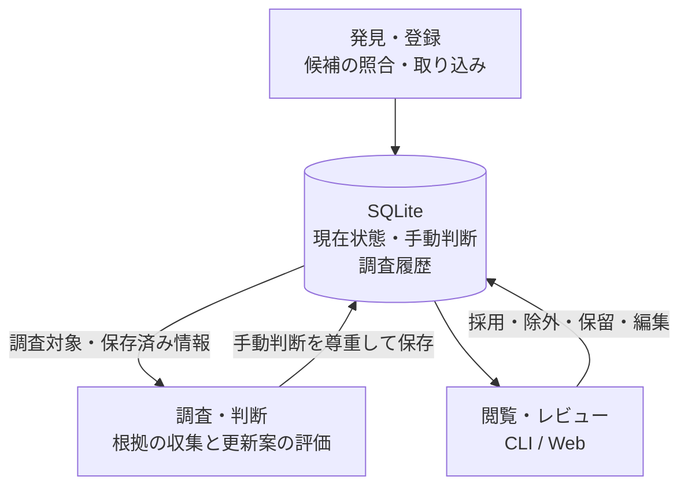

# Architecture

外部情報源から候補を登録し、登録プロジェクト（以下project）ごとに収集した根拠を評価して、紹介・追跡に使う現在状態をSQLiteへ保存します。CLIとWebは同じapplication serviceを呼びます。外部取得とLLMは主に調査時に使い、一覧・詳細・Explain（判定理由）は保存済み情報を読みます。

以下では、保存情報の取得をquery、変更操作をmutation、利用者をoperatorと呼びます。識別子・関係・手動判断を個別tableへ分けた保存形をnormalized row、それらを処理用dictへ組み立てることをhydrateと表記します。

## 全体の流れ

1. **発見・登録** — source別のsyncが候補を既存projectへ照合し、対象commandでは未知の候補を新規登録する。
2. **調査・判断** — enrichが根拠を収集し、resourceの帰属、説明、分類、稼働状態を評価する。観測したlinkやLLMの提案をそのまま採用するわけではない。
3. **保存・利用** — 現在状態と調査履歴を分けて保存し、CLI/Webで検索・レビュー・編集する。次の調査でもoperatorの採用・除外・保留を尊重する。

| 確認したいこと | 仕様 |
| --- | --- |
| 発見した候補の照合・取り込み | [発見と取り込み](specs/discovery-and-sync.md) |
| 調査pipeline・取得範囲・根拠 | [Investigation](specs/investigation.md) |
| resourceの帰属とprojectの統合・分離 | [Project境界](specs/project-boundaries.md) |
| 説明・紹介候補・追跡状態の決定 | [Project評価](specs/project-evaluation.md) |
| 現在状態・手動判断・履歴の保存 | [Project record](specs/project-record.md) |
| 長時間処理・中断・再開 | [Background jobs](specs/background-jobs.md) |

## 実行経路

公開shell入口は`bin/_project-registry-python`で専用Python世代を選び、実pathからCLI/Web/service/testを起動します。`bin/project-registry-python-env`と`scripts/project_registry_runtime.py`が保守時の世代準備・検査・選択を担当します。通常起動はuvやシステムPythonへ依存せず、Web workerとreloadは起動中の`sys.executable`を使います。更新には停止・新規起動が必要です。[環境の選択・切替・復旧](../user/python-environment.md)を参照してください。

CLIの`commands/`とWeb APIは入力をapplication serviceへ渡し、結果をtext/JSONまたはHTTP responseへ変換します。長時間処理ではCLIはserviceを直接呼び、Webは別processの`worker.py`を介します。serviceが進捗eventと終了resultを返し、enrichでは対象選択・保存・checkpoint・再開も担当します。

追跡状態レビュー（stalled / ignore / out-of-scope）は`application/review.py`が候補抽出・並べ替えと状態・メモの保存を担当し、対話CLIと非対話serviceで共有します。候補選択時のprojectと更新番号を`ReviewSnapshot`で保持し、利用者の入力後もそのsnapshotで保存競合を検査します。対話入力・理由の選択・表示は`commands/review.py`、候補ID・計画照合・進捗・中断はserviceが担当します。CLIのDB接続はコマンド入口で開閉します。

[App record export](specs/app-record-export.md)は保存済みprojectから公開用JSONを生成します。[LLM事例保存](specs/llm-case-store.md)は明示登録した入力・出力・判断をGit管理外のJSONへ保存し、通常enrichには接続しません。

### CLI・Webとapplication service

`application/presentation.py`が検索・queue・詳細のpayloadを組み立てます。Web APIはDB schemaとは独立した`api_version: 2`を持ち、詳細は`project`、`identifiers`、`relations`、`decisions`、`evaluation`、`investigation`に分かれます。同値identifierをまとめた表示でも、`entries`にrole・classification・providerの対応を保持します。

`application/explain.py`はCLI/Web共通で、保存済み状態とrelationから結論、適用rule、支持・反証signalを返します。外部取得・LLM・DB更新は行いません。

同時編集は自分のCLI、Web、worker間を想定します。Web内のmutationはlockで直列化し、process間ではproject更新番号と保存transaction内の検査で競合を検出します。詳細からのmutationは`expected_revision`を必須とし、古い詳細を`409 stale_project`で拒否します。紹介投稿の要確認はitem IDを指定し、保存時に現在の判断とproject更新番号を検査します。

### 一覧・詳細の検索経路

通常一覧は`projects`とnormalized identifier・relation・decisionへの`EXISTS` queryで絞り込み、全projectをhydrateしません。詳細は選択した1件の子行を読みます。文字列検索は保存済みfieldの部分一致で、操作は[Web UIガイド](../user/web-ui.md#登録プロジェクト)を参照してください。

紹介候補一覧は完全runtime viewを使い、読込み時の正規化結果をqueueとsignalで再利用します。先行絞込みとread snapshotの契約は[評価仕様](specs/project-evaluation.md#紹介候補の表示順位保留)に従います。

詳細のマージ候補は`/api/projects/{key}/merge-analysis`で別途計算し、重複候補の計算結果を推薦とExplainで共有します。比較集合は`project_record.list_duplicate_projects`が同じread snapshotから識別情報・必要なstate・identifier・decision・adoptionを組み立てます。この部分的なviewは保存不可で、projectや候補のcacheは持ちません。呼出元が比較集合を渡す経路はその集合を使います。

画面遷移時はブラウザが詳細とマージ解析の通信を取り消し、request世代とproject/revisionを照合して古い結果を描画しません。`request_cancellation.py`が接続断を検知し、applicationの確認点とSQLite progress handlerで協調的に計算を止め、DB接続等を解放します。別タブへは作用せず、計算中にproject revisionが変わった結果も破棄します。中断は即時の強制終了ではなく、HTTPS中継経由では切断が上流へ伝わることが必要です。

## Module構成と依存方向

以下は`scripts/project_registry_core/`配下です。WebのHTTP・静的UI・process管理は`scripts/project_registry_web/`にあります。

### 入口・処理の制御

| Module | 担当 |
| --- | --- |
| `commands/` | CLI引数・出力。queueの対話は`queue_interaction.py`、stalled/ignore/out-of-scopeは`review.py` |
| `application/` | CLI/Web共通service。`argparse.Namespace`やstdoutへ依存しない |
| `jobs.py` / `worker.py` | request/event/resultと協調的中断。workerはstdinの`OperationRequest`を実行しJSON Linesを返す |
| `application/sync.py` / `source_sync.py` | source別取得、watermark、既存projectへの接続 |
| `application/publications.py` / `publication_registry.py` | [Lexicon公開情報](specs/lexicon-publication-catalog.md)の取得・検証、保存、project候補への照合 |
| `publication_verification.py` | syncとenrichの検証結果保存。公開本文・観測時刻の照合と調査保存への接続 |
| `introduced_review.py` | 紹介投稿のURL別要確認・手動解消。判断はqueryの`sync_state`、紹介URLはproject本体へ保存 |
| `application/enrichment.py` | enrichの対象選択・transaction・保存・checkpoint |
| `enrichment_pipeline.py` | 1 projectのcollector・LLM・保存前更新の実行順序 |
| `application/enrich_prefetch.py` | LLM区間中の次の一件の先行取得。DBとLLMはcaller threadに保ち、使用前にsnapshotを照合 |
| `registry.py` | collector適用・finalizeの補助処理、merge/queue policy |
| `dev_database.py` | 架空定義から開発DBを生成・リセット。通常CLIのDB選択は`cli.py` |

### 観測・統合・評価

| Module | 担当 |
| --- | --- |
| `evidence.py` | `EvidenceBundle` v2、観測・relation・collector結果と失敗の型 |
| `investigation.py` | query planningとcollector。project dictを変更せずevidence bundleを返す |
| `repository_sources.py` | provider別metadata・README・tree・file取得と短期cache |
| `repository_material.py` | 取得済みfileからmanifest・configuration・Lexicon・source hintを抽出 |
| `repository_analysis.py` | confirmed repoの解析素材縮約、revision・policy単位の再利用、成功結果と最新試行の管理 |
| `service.py` / `tangled.py` / `relations.py` | service観測、Tangled PDS/UFOs、typed relation |
| `tangled_identity.py` | 同期用DID・handle双方向検証と取得失敗の分類。帰属・保留保存は`source_sync.py` |
| `oauth_metadata.py` / `oauth_scope_parser.mjs` | 取得済みOAuth metadataを公式SDKで解析。Nodeで外部取得はしない |
| `usage_material.py` | collection名に対応する宣言・record観測・原文の関連記述を抽出。用途判定はしない |
| `integration.py` | 観測をprojectへ適用 |
| `evaluation.py` | ownership・atproto寄与度・service statusの純粋評価 |
| `collection_trust.py` / `trust_graph.py` | Lexicon公開応答の検証・限定したcollection信頼policyと共通経路評価。取得・採用・DB保存は分離 |
| `editorial.py` | 説明と更新案・根拠参照・編集保護。通常triageとWeb編集で共有 |
| `atproto_usage.py` | 利用範囲の理由付き手動判断・解除・マージ。サービス確認・技術評価から独立 |
| `promotion_attention.py` | 候補再確認用snapshotと直近の明示操作。品質scoreや自動閲覧判定は持たない |
| `triage_reuse.py` | 入力・実行条件・手動判断・期限を照合し、triage成功出力を再利用。他の調査・適用処理は省略しない |

### 保存と外部接続

| Module | 担当 |
| --- | --- |
| `database.py` / `runtime_view.py` | schema・接続・normalized rowのsnapshotと処理用view |
| `project_record.py` | project shape、正規化、保存payload、hydrate、fetch/list/save、exact lookup、key割当 |
| `concurrency.py` | 更新番号trigger・短いtransaction・競合検査。外部取得・LLM中にwrite lockを保持しない |
| `storage.py` / `replay.py` | 調査履歴保存、network-free replay、fixture benchmark |
| `enrich_observations.py` | 比較用snapshotと処理時間。集計入口は`scripts/enrich_observation_report.py` |
| `llm_case_store.py` / `private_data.py` | 非公開事例保存と共通の認証情報除去 |
| `domain_policy.py` | 同梱PSLとhosting suffix設定によるdomain・tenant境界。依存・PSL欠落はエラー |
| `http_transport.py` | outbound URL検証、内部host遮断、redirect先再検証、HTTP呼出し |
| `identifiers.py` / `repo_urls.py` | URL・NSID・aliasの正規化、repo provider・owner判定 |
| `naming.py` | title短縮・name candidate・source labelのpure helper。採否は`registry.py` |
| `llm_transport.py` | command/互換endpoint呼出し、応答解析、timeout・error・metrics。prompt構築と適用は外側 |

### 依存境界の制約

- `source_sync.py`と`enrichment_pipeline.py`は保存を重複実装せず`project_record.py`を使う。`project_record.py`は`registry.py`へ依存しない。
- application・commands・pipelineにはdomain facadeとして`registry.py`への依存が残る。Web主要query/mutationはapplicationを通るが、bootstrap・検索・補助read pathには直接依存もある。
- `database.py`のopen/saveは`registry.py`や`project_record.py`をimportしない。
- 比較・migration用コピーの生成は`database.materialized_database_copy`がread-onlyの取得元接続、新規コピー先の排他作成、backup、commit・失敗時の削除を担当する。各materializationは必要なschema世代と変換・検証規則を持ち、既存コピーや正本を上書きしない。
- 分離したmoduleを旧symbol互換のため`registry.py`からre-exportしない。collectorのtestはHTTP transport、LLMのtestはcommand/endpointをfakeへ差し替える。

resource pageの統合は既存更新関数をprojectのcopyへ適用し、許可fieldの差分を返す暫定実装です。cacheと連続失敗を抑止するcircuit breakerはprocess・情報源単位で、process終了時に状態を失います。
