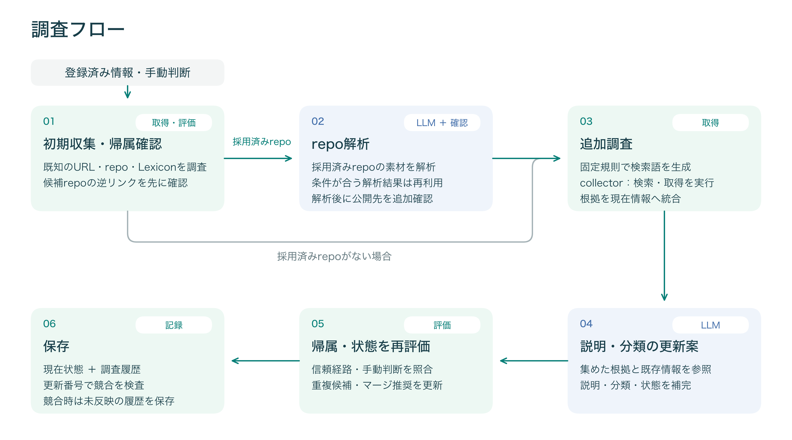

# Investigation Model

調査pipeline、外部情報源（source）からの取得・観測、判断材料となる根拠（evidence）、部分失敗とreplayの契約を定めます。登録済みprojectを起点に、外部情報を観測として集め、採用できる根拠を現在状態へ反映します。sourceごとの失敗を分けて記録し、一部を取得できなくても得られた根拠を保持します。保存した調査実行記録（investigation run）は、外部へ再接続せずに現行規則で再評価（replay）できます。以下のrunは、特に指定がなければproject一件に対する調査実行記録を指します。

## 取得・LLM利用の目的

情報源の取得は、未知対象の発見、帰属・信用判断、説明に使う材料を得るために行います。URLを保持すること、その本文を取得すること、結果へ利用することは別です。出力用に保持した規約等のリンクへ、調査上の用途を後付けしません。[識別子の役割](project-boundaries.md#識別子を発見調査出力に使う目的)と[人力にも使える調べ方](../../notes/research-methods.md)を参照してください。

LLMは、複数資料の内容や文脈を読み、名前・説明、利用範囲・技術的な価値、関係候補・要確認事項へまとめるために使います。repository解析は実装の材料をproject全体の説明へ接続し、triageは既存の理解と新しい資料から説明・判断案を作ります。これらは現行の役割であり、生成したことだけで正しさや紹介文への利用可能性を保証しません。検索語は採用済みの識別子と名前から固定規則で生成します。

調査や追加取得の必要性を人に判断させることは完成形ではありません。自動で判断・取得・更新できることを目指し、現行の手動deep調査やレビューは能力・資源の不足を補います。匿名browserではJavaScript描画後のログイン入口から、利用可能性・atprotoアカウント利用・要求権限などを日常的に調べたい意図があります。現行の取得範囲と負荷は[Static・Deep・Browserの調査範囲](#staticdeepbrowserの調査範囲)と[残件](../todo.md#説明更新の品質とservice監視)で区別します。

## Pipeline

調査は `collector -> evidence -> integration -> evaluation -> save` の順で扱います。

1. collector
   - query planning を含め、外部 source を読み structured evidence を返す
   - 接続済み collector は共有 project dict を直接変更しない
2. evidence
   - 観測と source の完了状態を JSON-compatible な bundle に正規化する
   - relation は subject、predicate、object、locator、抽出方法を持つ
3. integration
   - evidenceから既存project fieldへの適用を担う責務。実装は`integration.py`だけでなく`registry.py`の適用関数と、project copyからpatchを返すcollector adapterにも分かれる
   - projectの既存情報、手動判断による採用の抑止条件（manual guard）、複数の情報源による裏付け（corroboration）を照合し、operatorのconfirm/defer/blockを自動評価より優先する
4. evaluation
   - ownership、atproto寄与度、service status などを rule-based に計算する
   - network、DB、LLM に依存しない関数を優先する
5. save
   - `projects` を現在状態の materialized record として保存する
   - 同じ SQLite に input/output snapshot、評価、bundle、source 状態も保存する

Web detailはproject単位のinvestigation run summaryをSQLite rowから一覧し、選択したrunだけbundleをdecodeします。run detailのevidence/failureは上限付きで、raw HTMLやREADME全文を保存・表示しません。Replayは保存runを現行ruleで要求時に再評価するread-only処理で、結果をDBへ永続化しません。

serviceの稼働状態とNSID ownershipを確認するレビュー表示も、保存済みの現在状態、正規化保存したrelation、collectorごとの実行結果だけを読みます。画面表示のためにnetwork collectorを再実行しません。保存根拠がない状態は`not_observed`であり、到達不能・所有していない・permissionなしの確定結果ではありません。

### Enrichの実行順序



図は登録済み一件の通常調査の主要工程です。根拠の適用・帰属の評価は収集途中でも行い、repository解析とtriageは条件が一致する保存済み結果を再利用します。採用済みrepositoryがない場合はrepo解析を飛ばして追加調査へ進みます。

`enrich` は次の順で動きます。

1. seed由来の事実収集
2. service / repo / lexicon の確認済み情報を更新
3. lexicon repository単位で namespace 集約
4. confirmed repositoryの解析素材を収集し、revisionごとのrepository analysisを更新
5. GitHub repo / GitHub search / Bluesky search の structured evidence を収集
6. evidence を project へ統合し、rule-based evaluation / finalize を実行
7. local LLM による summary / category / status 補完
8. 再度finalizeし、重複候補・マージ推奨を更新

### 検索語の選択と追加検索

初期収集後のprojectから、検索先ごとに次の語を選びます。LLM呼出しはありません。

- 共通の第一候補は、サービスhost（`website_url`、次に`service_urls`の順）、authority domain、名前、最初のNSIDの順です。値がある最初のものを使います。検索結果が空だった場合の切替順ではありません。hostのサブドメインは保持します。
- GitHubは採用済みrepositoryの`owner/repo`があればそれを優先し、なければ共通の第一候補を使います。関連性と候補許可の条件を満たすrepoが得られなかった時だけ、補助語で一度追加検索します。補助語は名前を基本とし、名前がサービスhostと同じなら先頭のlabel、空またはドットを含む名前なら最初のNSIDを使います。NSIDもなければ元の名前を保ちます。第一候補と同じ語は追加しません。
- Blueskyのactor検索とpost検索は、それぞれ共通の第一候補で一度だけ検索します。異なる語をORで束ねません。

検索は一projectあたり最大4回（GitHub 2回、actor 1回、post 1回）です。材料がなければ該当検索は省略します。候補actorのauthor feed取得は別に最大2回で、失敗時のretryもこの4回には含めません。共有hostのパスから個別サービス名を推測する処理はありません。検索結果の帰属確認・採用規則は語の選択とは別に適用します。

GitHub検索結果のowner加点は、採用済みrepositoryと同じGitHub ownerである場合に限ります。GitHub usernameとBluesky handle、domain、project名の綴りの類似からownerの同一性を加点しません。project名・説明・URL等の文字列による関連性評価は別に残し、検索の加点を帰属の確定へ読み替えません。

### 一括調査の先行取得

一括enrichは既定で、現在projectの最初のLLM呼出し中に、選択順で直後のproject一件の初期収集を進めます。初期収集はLexicon・record sample・既知repository・service・candidate repositoryの帰属確認を含み、repository analysisより前で止めます。通常の逐次経路も同じ`collect_initial`を使い、取得対象・検索予算・prompt・model・適用規則は変えません。triage再利用hitでも、repository analysisに実呼出しがあればその区間を利用します。両方を再利用できた回にはLLM待ち時間を使う先行取得はありません。

先行threadには所有するproject snapshotだけを渡し、DB接続・LLM・保存・checkpointは渡しません。LLM呼出しが先に終わった場合は先行収集の完了を待ってから現在projectの後続取得へ戻ります。このため、project内の既存取得並列数は維持し、project間でcollectorが同時実行されることはありません。process-local cacheへのproject間同時アクセスや同じURLへの競合fetchを増やさず、LLM同時実行も一件です。検索のrequest budgetとGitHub request metricsは従来どおりcollector単位です。

最大保持量は現在projectに加えて先行一件のsnapshot・収集結果です。取得の完了が早くても次のprojectへ先読みを延ばしません。cancel済みなら新たに先行取得せず、開始済みの初期収集はその区間を完了して回収します。停止までには現在projectの完了時間と、先行一件の初期収集残時間がかかり得ます。使用直前のrevision・alias・選択条件の再確認と、未使用成果・再開の扱いは[background jobs](background-jobs.md#enrich-checkpoint)を参照してください。

同じ固定応答では調査の意味を揃えますが、project間の取得順と観測時刻は変わります。実外部情報の更新、cacheの期限、共有APIの残quotaが変化する場合は、どのprojectが新しい情報やrate limitを観測するかも変わり得ます。総request数が同じでも単位時間のrequest数は増え得ます。逐次比較にはCLIの`--no-prefetch`（requestの`prefetch=false`）を使います。

## 根拠と調査状態

### Evidence classification

- `confirmed`: operator decision、first-party claim、検証済み identity path など強い帰属を持つ観測
- `candidate`: 関連性はあるが、帰属または意味の追加確認が必要な観測
- `derived`: 他の観測から決定的に導出した query、正規化結果、usage relation
- `heuristic`: score、文字列類似、community source など誤判定し得る推定

ここでのclassificationはEvidenceRecordの根拠の性質を表します。project fieldのconfidence（評価の確度）やidentifierの採用状態は別に保持します。integrationが採用の抑止条件とprojectの既存情報を照合し、確定値、候補値、観測のどこへ反映するかを決めます。

### EvidenceBundle v2

通常readerが受理するのはEvidenceBundle v2だけです。旧v1 bundleの互換readerは提供しません。

- `EvidenceBundle`
  - `schema_version`, `project_key`, `collected_at`
  - 順序付き `records`, `failures`, `collector_results`
- `EvidenceRecord`
  - `kind`, `source`, `classification`, `observed_at`
  - JSON-compatible な `value` と query、score、repo path などの `context`
  - service verificationのHTML/link/URLはcollector内の判定後に保存budgetを適用し、観測総数とdigestを併記する
- `CollectorFailure`
  - `source`, `operation`, `target`, `category`, `message`, `retryable`
  - `retryable`は最終的な失敗の性質を示すmetadataで、次runの自動予約・再試行時刻を決める指示ではない
- `CollectorResult`
  - `success | partial | skipped | rate_limited | failed`
  - request/result 数、cursor、stop reason、retry 時刻、cache hit
  - GitHub collectorは実際に送信したHTTP request数を記録し、process-local cache hitはrequest数へ含めない
  - GitHub API応答に`X-RateLimit-*`または`Retry-After`があれば、最後に観測した`limit`, `remaining`, `used`, `reset`, `resource`, `retry_after`を`rate_limit`へ保存する

#### Collector history projection

repository homepageとREADME公開先の観測は、未採用URLの取得結果とprojectへの採用判断を分けます。URLごとのlaneとassessmentをbundleへ残し、replayでも現在の起点とguardを再評価します。取得対象、候補化、browser/protocol確認、衝突検査、旧assessmentの扱いは[Repository homepageと公開先の評価](project-boundaries.md#repository-homepageと公開先の評価)を正本とします。

同じ情報源のcollector結果を集約する場合、rate limit観測は最も新しいcollector resultの値を保持します。

通常接続済みcollectorは`CollectorResult`を明示的に返します。record/failureからsource状態を推測する互換処理は現行導線では使いません。failure categoryはtimeout、rate limit、request budget、network error、remote 5xx、invalid response、browser error、collector errorなど、再試行・運用判断に必要な単位で固定します。GitHubの403は`X-RateLimit-Remaining: 0`または`Retry-After`がある場合だけrate limitとして扱い、それ以外はforbiddenとして区別します。

主要 relation predicate は `defines_schema`, `uses_collection`, `mentions_collection`, `official_account`, `operates_service`, `project_repository`, `owns_repository`, `requests_permission`, `redirects_to` です。同じ README から複数抽出した claim は独立 source と数えません。`official_account`の対象URL・公式性の根拠・再収集時の置換は[公式Bluesky account](project-boundaries.md#websiteが示す公式bluesky-account)に従います。

### 調査状態

次を区別します。

- `success`: 予定範囲を完了した
- `partial`: usable record と failure の両方がある
- `skipped`: 設定不足、不要判定、budget 超過などで実行していない
- `rate_limited`: upstream 制約で打ち切った
- `failed`: usable result を得られなかった
- 証拠なし: 完了した collector が対象 evidence を返さなかった
- 未調査: collector 自体が実行されていない

「証拠なし」を否定的事実へ変換するには、対応 source が成功して必要範囲を走査したことが必要です。

### Relationと採用の境界

collectorの観測からrelationを作ることと、identifierの帰属・採用は別の判断です。relationの意味、`defines_schema`の成立条件、candidateの採用規則は[project境界](project-boundaries.md#現行の採用規則)を正本とします。service到達の観測自体は、採用できるかにかかわらず`service_verification`へ残します。取得失敗を否定や過去観測の消滅へ変換しません。

## Source別の観測

### Lexiconとauthorityの観測

- 入力:
  - `input_nsids`
  - `resolved_nsids`
  - GitHub repo から後で見つかった NSID
- 取得の流れ:
  - `_lexicon.<authority_domain>` の TXT を引いて DID を解決
  - DID document から PDS endpoint を引く
  - PDS の `com.atproto.repo.getRecord` で `com.atproto.lexicon.schema/<nsid>` を引く
- ここで confirmed に入るもの:
  - operator/source assignment済みの`resolved_nsids`
  - confirmed developer DID、またはconfirmed root serviceとの相互trust pathが成立したcandidate NSID
  - 同じprojectの独立して採用済みLexiconと、直属authority・検証済み発行DIDが一致する既存candidate NSID（[範囲付きpublication policy](project-boundaries.md#承認済みlexiconと同じ発行元による信頼の補強)）
- 解決結果として保存するもの:
  - record schemaの場合の`record_creators`
  - `authority_domains`
  - `lexicon_resolution_entries`と`did_publishes_schema` / `domain_publishes_lexicon_record` / `collection_authority_domain` edge
  - 新しい取得結果ではDNSを引いた`authority_domain`をsnapshotに明示し、DID documentのid、schema record URI、`$type=com.atproto.lexicon.schema`、`lexicon=1`、matching schema id、record、space、query等の型別条件を照合した場合だけ`publication_validation`を保存します。検証version・schema id/type・本体の正規化JSON SHA-256を保持し、署名付きrepository proofとは区別します。非recordは`nsid` nodeを使い、record samplingとcollection固有経路から外します。space宣言を所有・実利用へ読み替えません。型別条件・期限・hash照合は[公開情報仕様](lexicon-publication-catalog.md#検証と型別処理)を参照してください
  - 同じ解決対象・発行DIDの重複は最新の観測を優先し、未検証になった応答も古い検証結果を置き換えます。snapshotの観測時刻を再利用するため、replayで新しい外部観測を行ったようには扱いません
- ここで candidate に留めるもの:
  - lexicon description 由来の `summary_candidates` / `tagline_candidates`
- 保守的な点:
  - lexicon schema が取れても、それだけで `website_url` や `service_url` は confirmed にしません
  - authority domain 由来の service URL は、NSIDから直接candidate保存せず、probe結果を見てから候補化します
  - authority probe は完全一致hostと registrable parent を同一chainとして並列fetchします。完全一致hostが2xx/3xxなら親は捨て、完全一致hostが4xxまたは恒久的なDNS不在で、親が2xx/3xxの時だけ親をfallback候補として扱います。timeout、DNSの一時障害、5xx、TLS失敗、接続拒否、その他のnetwork errorでは親へ広げません
  - 完全一致hostがregistrable parentへsame-site redirectする場合は、内容比較ではなく明示的なredirectを根拠に最終URLをcanonical candidateとして扱い、redirect元を独立したauthority candidateとして重複保存しません
  - same-site redirectが要求先と同じhost・schemeの利用画面やログイン・登録画面へ進む場合は、元のoriginをauthority candidateに残します。転送先URLはprobe観測として保持し、ログイン・登録pathを別のserviceとして候補化しません。この例外には利用画面を示す状態（`live / beta / invite_only / private`）、または`unverified`を補強するページのAT Protocol根拠・record sample URLのhost一致が必要で、HTTP 200だけの停止・空画面は候補化しません。転送先のguard、補助的な説明・文書ページ、HTTPSからHTTPへの変更は除外し、通常のauthorityとの対応・AT Protocol根拠の条件も適用します。別hostへのsame-site redirectは上記のcanonical candidate経路で扱い、authorityによる候補化だけではconfirmed帰属にしません
  - authority domain 由来probeが成功し、実service surfaceらしく、完全一致authority hostのページ自身にAT Protocolの具体的な痕跡がある、record sample URLによるhost一致がある、または上記fallback条件がある場合だけ `service_url_candidates` に残します
  - authority domain 由来の失敗probe URLや、上記の補強がない旧candidateは、confirmed/supported/manual service として残っているものを除き `finalize_project_shape()` / `repair-db` で削除します
  - ページ上のAT Protocol言及はcandidate保存にだけ使います。`supports_project`やconfirmedへの自動昇格根拠にはしません

### Repositoryの取得とsnapshot

relationとcandidate生成はsnapshot budget適用前の全取得結果から行います。

- 採用済み`repo_url` seedは`project_repository_urls`にconfirmedで入り、入力元とは別に`confirm_identifier` decisionを持ちます
- repo metadata から取るもの:
  - repo 名は `name_candidates` に入れ、`atproto-visualizers` のような slug はハイフン込みの全体を名前候補として扱います
  - `description` は `summary_candidates` / `tagline_candidates`
  - `homepage` は公開URLとして妥当ならconfirmed `repository_homepage` relationとして保存する。homepage単独ではservice候補やtrust edgeを作らない。通常enrichは現在採用済みrepoのhomepageからWebページ（docsを含む）を元のpathで取得する。未判定ページは`repository_homepage` laneで観測だけを保存し、既にexact URLがserviceと確認済みなら従来のstatic laneを使う
  - `updated_at` は `source_repo_records[].updated_at`
- tree / lexicon hint の扱い:
  - `lexicon/`, `lexicons/`, `schema/` 配下などの JSON を lexicon 候補として走査します
  - その JSON が lexicon らしく、かつ `project_owned_lexicon_nsid()` が真の時だけ project 自身の NSID として採用します
  - ownership が弱い時は `github_repo_lexicon_reference` として investigation log に残すだけです
  - test / fixture / vendor / generated / docs / example path は `mentions_collection` に留めます
- source code の意味解析:
  - collection候補はドット区切りのtoken全体を[NSID構文](https://atproto.com/specs/nsid)で検査します。3 segment以上、全体317文字以下、authority 253文字以下、各segment 63文字以下とし、authorityの数字・ハイフンとcase-sensitiveな最終nameの英数字を区別します。`_`等で不正tokenを分割して、その一部をNSID候補にしません。JWT等の長いドット区切り値も同じ規則で棄却します
  - write/createRecord 系は `uses_collection` の write
  - read/query/subscription 系は `uses_collection` の read
  - operation が取れない出現は `mentions_collection`
  - package/library 提供、service 実装、用途不明を context に分けます
  - collectorは不正NSIDのsource hintをsnapshot・relationへ展開しません。保存済みの不正NSID relationも通常のfinalize、replay、`repair-db`の再評価で現在状態から除きます。`repair-db`は他の正規化・派生値更新も含むためdry-run全差分を確認してから適用します。保存済み調査履歴の本文・snapshotは書き換えません
- README のリンクの扱い:
  - 同一 repo へのリンクは confirmed の補強に使います
  - 別 repo は `repo_candidate_allowed_for_project()` を満たす時だけ candidate に入れます
  - 外部 service URL は `repo_context_service_candidate_allowed()` を満たす時だけ candidate に入れます
- 同じrepo URLがinitial/provider viewの両方に現れても、一runでは一度だけinspectします
- 保存snapshotはGitHub API response全体ではなく、integrationで使うrepo fieldだけを保持します
  - source semantic hintはtyped relationへ展開し、snapshotには件数だけを残します
  - README URLは最大64件、JSON 16 KiB、1 URL 2 KiBです
  - lexicon hintはschemaの再評価に使うため、このsnapshot縮約時点では保持します

### Repository analysis

lexicon enrich に成功した場合、LLM evidence には lexicon schema の縮約サンプルも入ります。さらに `ufos-api.microcosm.blue/records` から recent record sample を取得できた場合は、それも判断材料に含めます。

confirmed repositoryは通常`enrich`中に専用のrepository analysisを行い、結果を`state_json.evidence.repository_analysis_results`へ保存します。candidate repositoryは相互trust確認に必要な限定取得以外では解析せず、confirm後に初めて対象にします。GitHubとCodebergはmetadata、README、tree、主要manifest、documentation / deployment設定、Lexiconを取得し、READMEとdescriptionだけでは目的を説明できない場合に限ってsource候補を最大4 file、各file最大2 excerptへ絞ります。Tangledは現行取得能力に合わせてmetadata、README、限定treeを使い、取得できない範囲を`coverage`で`unavailable`とします。未対応providerも黙って欠落させず`coverage.reason=unsupported_provider`を保存します。

repository analysisでは、repositoryのrevisionを固定して量を制限した解析素材（material）を`repository_analysis_material`としてrunへ保存し、解析recordはrepo URL、repositoryの`source_revision`、material hashでその素材を参照します。READMEは先頭・末尾を含む最大6 block、合計6,000文字として元の行番号を保ち、選択数と切り詰め状態をcoverageへ記録します。LLMへ渡すのは本文を持つevidence blockだけで、tree pathは候補抽出やcoverageに使っても解析で述べる事実（claim）の根拠にはしません。repository metadataはdescriptionだけをclaim可能な本文とし、name、homepage、is_templateはcontextまたは決定的抽出に限ります。観測とcollection利用は、素材から事前生成した候補集合（closed candidate）のIDだけをLLMに選ばせます。候補外のIDは保存前検査で棄却します。README由来のcollection candidateはreverse-domain authorityが小文字でpublic suffixから始まるものに限り、case-sensitiveな最終nameとoperationを一体で固定します。候補が空なら空配列を要求します。

`repository-analysis-v16`では、documentation公開の記述があるREADME blockも公開先URL候補の対象にします。URLは本文中の正確な値を保持し、homepage metadataだけでは宣言候補を作りません。設定ファイル・READMEの`declares_documentation_site_url`候補をLLMが返す場合、`applicability`で`current_project` / `negated` / `hypothetical` / `third_party` / `obsolete` / `uncertain`を区別します。`current_project`だけを観測へ反映し、区分が欠けた回答も棄却します。候補IDの選択だけでは、否定・仮定のURLを公開先と誤認する実例があったためです。この観測は従来どおり`role=docs, confidence=candidate`のresource候補へ接続し、project siteやserviceの自動確定、独立した運営relationの生成には使いません。v15以前の解析結果はv16のcache hitにはしません。

repository analysisの出力は、短いsummaryとその`summary_evidence`、複数の`observations`、根拠位置を持つ機能記述（`capabilities`）、大小文字を保持したcollection利用です。観測述語はCLI entrypoint、import可能package、service entrypoint、deployment設定、Lexicon定義、外部hostへの組込み（host integration）、documentation source / generator / site URL / deploymentなど、同じrepository内で併存できる事実を表します。`basis=declared|observed|inferred`は、それぞれ明示された宣言・実装等の観測・推定という解析上の根拠の種類を表し、帰属の信頼度とは分けます。pathだけのhost integrationは`inferred`に留まり、browser extension宣言にはmanifestまたはREADMEの明示を必要とします。Lexicon JSONの存在はcollection ownershipを確定しません。

証跡は別のfact IDを作らず、解析対象`source_revision`へ結び付く`path + line`または`path + json_pointer`を各claimへ直接保存します。同じ根拠本文をclaimごとに複製せず、重複を除いたbounded excerptを結果の`evidence_excerpts`へ最大6件、各600文字で保存します。triageへ渡す時は旧形式のclaim内excerptも同じ形へ縮約します。LLMには、README、metadata、manifest、configuration、Lexicon、source excerptから作った利用可能な根拠位置を、prompt内だけで有効な`E01`のような短い番号とともに渡します。LLMは番号だけを返し、保存前に対応する根拠位置へ戻します。番号自体は保存しません。ファイル一覧のpathだけでは内容を裏付けられないため、LLMが新しいsummaryやclaimの証跡として使うことはできません。tree pathから安全に決められる観測は決定的な抽出処理だけが追加します。summaryにも1件以上の根拠位置を必須とします。repository本文はuntrusted dataとして扱い、READMEやsource内の指示に従わないことを専用promptとtriage promptの両方で明示します。

cache identityはcanonical repo URL、`source_revision`（取得できないproviderでは`material_hash`）、`policy_version`の組です。成功結果と`last_attempt`は分離し、失敗時に旧成功結果のrevisionやpolicyを書き換えません。直前の根拠付き成功結果はtriageへ`stale=true`で渡しますが、旧形式の根拠なしsummaryは渡しません。timeout、rate limit、HTTP系など一時的な外部失敗だけは同じmaterialとpolicyへの再試行を24時間抑制し、LLM未設定、endpoint非互換、invalid response、local command失敗は設定修正後の手動再実行を妨げません。run evidenceにはbounded materialとそれを参照する解析結果を別recordで残し、current stateにはrepoごとの最新成功結果と最新試行だけを残します。

LLM endpointまたはmodel出力をJSONとして解釈できなかった場合、run metricsには失敗段階、UTF-8 byte数、SHA-256、JSON構文エラー位置、先頭と末尾がJSON記号か、code fenceを含むかだけを記録します。利用不能だった応答本文は保存しません。これにより、出力上限で途中終了した可能性と形式違反を、repository内容を追加保存せず区別できます。

triageへ渡す解析結果はconfirmed repoだけを対象に最大6件とし、operator-confirmed repo、代表repo、coverageの順で優先します。入力予算を超える場合は各repoのsummaryとその根拠を先に残し、claimを根拠位置ごと省略して未使用のexcerptも除きます。省略したclaim・excerptの元件数と採用件数は当該repoの`coverage.triage_input`に記録し、repo全体を省略した場合は`evidence_budget.omitted_repository_analysis_urls`にURLを記録します。repository observationはproject categoryやidentifier confirmを直接上書きしません。categoryはservice、collection、現在profileなどを合わせたproject-level triageが決めます。`lexicon`はschema自体が追跡対象である積極的根拠を必要とし、NSID seedやLexicon JSONの存在だけでは選びません。repositoryが宣言したdocumentation site URLは`docs` roleのcandidate resource URLに留めます。

### Tangledの調査

- confirmed developer handleがある通常enrichでは、handle -> DID -> PDSを解決し、`com.atproto.repo.listRecords`で本人のTangled repo recordを取得します
- 一覧の各recordはDID→repoのconfirmed `owns_repository`として保持します。これはaccountの所有観測であり、登録projectへの所属ではありません。`did_links_repo` edgeもauto-confirm対象外です。旧`project_repository`のうちDID→repoかつ`pds_list_records`の形だけを、共通relation正規化で`owns_repository`へ読み替え、元predicateをcontextへ残します。読込みは正本rowを一括更新せず、通常保存・replayでは現在の意味で保存します
- `tangled-project-repository-v1`では、既に採用済みのrepo URL、repo名とproject名の完全一致（空白とハイフンの差を許容）、record websiteと採用済みservice／代表Websiteの正規化後の完全一致をproject固有の根拠とします。名前・websiteの一致で追加するのはcandidateまでで、project間の同一性やマージは決めません。同じowner、説明文の単語一致、過去snapshotのscoreだけでは候補登録しません。repository共通入口でもowner一致単独を候補根拠にしません
- repo名の一致は、観測したrecord名を含むcanonical Tangled URLからcleanup・保存後も再評価します。一時的に渡されたmetadataがなくなったことや、別forgeのowner名との不一致でこの候補根拠を失わせません。現在のproject名が一致しなくなれば名前一致の根拠は解除し、他の有効な根拠があるかを通常の候補規則で確認します
- PDS recordのwebsiteは`repository_homepage`（method: `pds_repo_website`）として保持し、保存時も現在の採用済みservice／代表Websiteとの完全一致を再評価します。同じsource・repoの新しいrecordで置換し、websiteなしも古い観測を解除します。古い観測による上書きはしません。これにより別名repoの候補は保存後も残りますが、websiteの変更や参照先の除外後にはその根拠だけで候補を維持しません。これはpageの指定観測であり、service roleやrepoの自動採用ではありません
- PDS recordの名称・説明・website、repo inspectionのREADME本文・リンクは、現在採用済みでblock/deferされていないrepoだけからprojectの候補情報へ反映します。候補repo・所有一覧の他repoからは反映せず、ownerをdeveloperとして自動採用することもありません。PDS由来の名称・説明のsourceにはrecord sourceにrepo URLを付け、同じownerの別repoと区別します。保存済みの誤候補や候補テキストはこの変更だけで削除せず、手動判断・他sourceを保護する既存データ補正で扱います
- accepted source repo URLがTangledの場合は、repo root HTMLを読み、READMEを`raw/{ref}/{path}` から取得して `tangled_repo_inspection` evidenceを作ります
- owner DID一致や共通websiteは補助根拠ですが、actorやwebsiteは複数projectに対応し得るためproject同一性の照合には使いません
- Tangled repo inspection はREADME URLと短いexcerptを候補テキスト・候補URLに反映します。GitHubのrecursive tree API相当の完全なcontents取得ではありません

### Service pageの観測

service surfaceは、機能を利用・操作するために到達するURL上の画面やAPIを指します。観測の`lane`は、通常の静的取得（`static`）、追加ページ調査（`deep`）、匿名browser確認（`browser`）などの調査経路を区別します。同じURLでも経路ごとに結果を保持します。

- 各 URL を 1 回 fetch し、HTML から次を見ます
  - HTTP status
  - title / meta description
  - 生テキスト
  - ページ内リンク
- `normalize_url()` は network を伴わない文字列正規化だけを行います
  - `http` と `https` は無条件には同一視しません
  - redirect の同一視は service probe の evidence として別扱いします
- service probe は `requested_url` / `final_url` / redirect flags を保持します
  - same host の `http -> https` redirect だけは canonical service URL として `https` 側へ寄せます
  - same site family のredirect先がprojectを支持する場合は、Websiteの有無に関係なくservice URLだけを更新します
  - service probeから`website_url`は設定・更新しません
  - cross-host redirect は investigation log に残し、redirect 先が project を支持する場合だけ candidate に入れます
  - cross-host redirect は自動で同一 service として confirmed にはしません
- service probeの判定とrelation抽出には取得したresponse全体を使い、EvidenceBundleと現在状態へ保存するページ本文・linkは次の上限で代表部分を選びます。
  - `html_extract`: UTF-8で最大12 KiB。全文のSHA-256と取得時byte数は別に保持
  - `links`: 最大128件かつcompact JSON 64 KiB。1 linkのtextは512 bytes、URLは2 KiB
  - `urls`: 最大192件かつcompact JSON 32 KiB。1 URLは2 KiB
  - repo、Bluesky profile、docs/support/status/privacy/login等の役割を持つlink、同一host系link、その他の順で残す
  - 観測総件数を別fieldへ保存するため、保存件数をページ全体の件数と取り違えない
- `service_verification_results`は`lane + requested_url`ごとの最新観測を最大32組保持します。時系列の確認は`investigation_runs` / `collector_runs`を使います。

### atproto利用の関連記述

`usage_material.py`は、保存先・読取り・書込みを検討するための検索候補を取り出します。主機能での利用判定・寄与度・所有の根拠を自動確定する処理ではありません。ページ本文、ページ説明、browserの保存済み本文、confirmed repositoryの現行解析に付随するREADME原文抜粋を扱います。repositoryの生成summaryは検索対象にせず、既存解析が保持した原文だけを使います。README全体の取得率や、先行解析での原文選択の妥当性は保証しません。

成功したserviceのHTML取得時、先頭12 KiBの保存へ切り詰める前に、標準`HTMLParser`で最大1,048,576文字を読みます。head/script/style/template/noscript/svgを除き、block要素の改行と空白を正規化します。CSSの可視性判定やJavaScript実行は行わないため、実画面で見える本文の保証ではありません。取得時点で既知のcollection名を最優先に、PDS・personal data repository・AT Protocol・Bluesky等の表記を検索します。近傍の連続した最大800文字を4箇所まで残し、否定や予定を正例へ分類しません。選んだ範囲、検索語、省略flag、検索本文のhash・文字数、選定versionと`searched_collections`を`service_verification.atproto_text_candidates`へ保存します。文字位置はHTMLではなく正規化した検索本文上の0始まり半開区間です。

通常のservice観測の適用・保存・replayを使います。既存観測は保存済みHTMLの範囲だけを読むため、以前切り捨てた本文を回復できません。browserは既存の保存抜粋、ページ説明は既存description、READMEは既存の原文catalog内を検索します。取得失敗・projectを支持しないservice・stale repository解析を表示材料にしません。

Web詳細の`service_ownership_review.atproto_material`は読取り時に組み立てるviewで、追加通信・LLM・DB書込みを行いません。最大12資料を表示し、既知のcollection名と本文内の同じ表記を照合します。収集後に新しいcollectionが分かった場合は保存済みHTMLの範囲も検索し、以前の抽出にない候補を別のcoverage・位置で追加します。同じ調査内でもservice取得後に初めて判明したcollectionや、切捨て済み本文の記述を、最初の全文抽出へ遡って追加することはできません。

`collections.rows`は保存済みの個別repo宣言、record型Lexicon、recent record sample、collection集計を完全一致するNSIDで束ねます。宣言元URL・時刻・操作、schemaの説明・record key・保存されているfield定義、recordのDID・rkey・field名、保存済み集計を分けて表示します。schemaのfieldが圧縮済みの場合は未保存とし、recordサンプルのfieldをschemaの定義へ補完しません。schemaの取得対象NSIDとidが食い違うものは結合せず、query・procedure・permission setのschemaはcollectionにしません。wildcardや未解決includeも個別collectionへ展開しません。record内の`$type`不一致は表示し、本文の値を一覧へ複製しません。これらの結合は作成アプリ・所有・実利用・主機能との意味上の対応を確定しません。

collectionの表示・検索は最大64件、schemaのfield表示は最大16項目で、省略を明示します。64件を超える場合は複数種類の材料があるcollectionを先に表示します。schema・recordに元々観測時刻がなければ推定せず不明とします。既知名の結合と本文検索は既存収集の結果を使い、権限セット解決、追加のschema取得、record取得を起動しません。

未観測、HTMLから本文を取り出せない状態、検索一致なしを区別します。検索一致なしも非利用の確定ではありません。今回のviewは通常triageの`description_sources`へ追加せず、LLM入力上限・自動利用範囲評価・紹介順位規則は変えません。検索候補の改善と意味判定の精度改善は別です。

### OAuth client metadataの観測

service pageから発見したmetadata候補（1 pageあたり最大3 URL）を従来のHTTP collectorで取得し、`scope`を公式`@atproto/oauth-scopes@0.5.12`で解析します。`oauth_metadata.py`がNode bridgeを呼び、構文・対象・操作・audienceの検証はSDKへ任せます。追加HTTP、LLM、ソースコード探索は行いません。Node処理は1回5秒まで、scopeは16,384文字まで。同一processではscope文字列ごとに成功した解析結果を128件までcacheし、DB読込・表示・replayでは保存済み解析だけを使います。

`repo`のcollectionとcreate/update/delete、`rpc`のmethodとaudience、`blob`、`account`、`identity`、基本scope、移行用scopeを分けます。操作の省略時や複数指定、percent encodingもSDKで扱います。`include`はpermission setのNSIDとaudienceを保存しますが、参照先の取得・展開は未実装で、常に未解決と表示します。未対応／不正なtokenは捨てず`unrecognized`へ残し、部分解析とします。

`oauth_client_metadata` EvidenceRecordは取得URL、取得時刻、申告されたclient_id/client_uri、元のscope、parser versionと解析状態を持ちます。client_uriをサービスの所有確認に使いません。scope欠落・空・非文字列・長さ上限・parser利用不可を区別し、未取得や`atproto`のみと混同しません。長さ超過時は先頭16,384文字と省略flagを保存し、部分文字列を解析しません。HTTP成功と解析失敗はcollectorのfetch/parseに分けます。

metadataは要求できる権限の上限の宣言であり、実際のgrantや操作実績ではありません。`atproto`のみでも公開データを読め、他のclient・server accountの書込み有無も分からないため、`atproto_auth_only`や主機能での利用範囲を自動確定しません。個別のrepo NSIDと未解決includeは従来どおり`requests_permission` relationへ射影し、contextに元のtoken・操作を残します。wildcard、RPC、その他scopeをcollection NSIDや所有根拠へ変換しません。既存の寄与度評価規則と紹介順位規則は変更していません。

metadata URLごとの最新観測をcurrent stateに保持します。scopeが減った場合は同じURL由来の古いpermission relationを置き換え、古い観測のreplayやmergeで復活させません。取得失敗だけなら前回観測を維持し、失敗は調査履歴へ残します。従来のrelationだけでは元のscope全体を復元できないので、新しい解析への更新にはmetadataの再取得が必要です。

仕様根拠: [OAuth](https://atproto.com/specs/oauth)、[Permissions](https://atproto.com/specs/permission)、[段階的なscope要求](https://atproto.com/guides/oauth-patterns#progressive-scope-requests)。主機能との対応や寄与度の再設計は、公式の保存先説明・schema・record等を合わせて評価する別段階です。

### Static・Deep・Browserの調査範囲

`resource_url_records`には調査資料とapp lexicon向け補助リンクが共存します。現行deep調査は保存済みresource URLを先に並べ、service由来の固定path等を加えた先頭最大6件を取得します。roleごとの調査価値を選別する方式ではなく、規約・status・Web Manifest等も枠を使い得ます。専用のmanifest解析やstatus page監視を提供するという意味ではありません。補助リンクの保持・exportと取得優先度は別の判断です。

- 通常 enrich は service top page と same-site follow-up を軽量 probe します
- `--deep-investigation` は `resource_url_records` と service surface から優先ページ候補を作り、最大 6 page を追加 probe します
  - `/about`
  - `/docs`
  - `/faq`
  - `/app`
  - `/login`
  - `/signup`
- deep page probe は `service_status` / `service_status_confidence` / `service_status_evidence` を補助更新します
  - URL の path から `deep_page:about`, `deep_page:docs`, `deep_page:login` などを evidence に追加します
  - この処理は service URL の confirmed 化や merge 判断までは行いません
- `verify-service -p KEY --lane browser [--execute]` は optional Playwright で anonymous navigation を行います
  - 同一 site の login/signup link を最大2件追います
  - 認証入力、登録、投稿は行いません
  - browser結果は surface 到達と runtime/network error を evidence に残します

### 未採用URLの調査

`investigate-service-urls`は、採用済みサービスの稼働再確認とは別に、既存service candidate、採用済みrepositoryの現行公開先・役割未確定homepage、現行owned NSIDの完全一致authorityで静的取得に成功したURLを調べます。空HTMLだけに限定しません。生のauthority逆引き、一般の投稿・record内リンクや`evidence_urls`から巡回先を増やしません。既知のdocs/package/account/repository/funding URL、補助ページ、API/PDS宣言、非公開address、guard・非現行URL・他projectの確定URL・競合するrepository公開先は対象にしません。API/PDSの実在確認は既存protocol確認の責務です。

対象stateは`active / stable / stalled / out_of_scope`です。紹介予定とservice未採用projectを優先し、出所別に巡回して1 project・同一URL各1件を選びます。未試行・意味のある入力変更を4巡、期限到来の再試行を1巡で選び、空いた枠は他へ回します。rootの観測時刻だけでは再取得せず、出所・現行NSID・公開先の根拠・ページ内容hash・policyの変更で再評価します。成功したが帰属不明の観測は入力変更まで再巡回しません。一時失敗は7・30・90日後を再試行対象とし、404/410は入力変更まで保留します。

ブラウザcollectorは共有し、未採用側は`browser_discovery` laneと出所付きhypothesisを保存します。最初のpageが正常に取得・可視観測され、利用画面とAT Protocol/PDSの具体的な痕跡が同じexact URLにある場合にcandidateを支持します。ログイン欄やHTTP成功だけでは確定せず、未採用観測から`website_url`・confirmed・projectの稼働状態・追跡状態・`last_enriched_at`を変えません。表示された`continue to PDS`も認証入口の観測に含めますが、認証の成功ではありません。既存candidateの取得失敗は自動block/削除にしません。

既定は50 URL・900秒で、件数または経過時間で新しいURLへの着手を止めます。URL内のnavigationにも残り時間を渡し、1 URLの操作予算は最大45秒、同一siteの認証入口は最大2件です。ブラウザ起動・DNS・終了処理を含む厳密なprocess終了期限や、subresource込みのHTTP request数の上限ではありません。取消しはURL境界とnavigation前で確認し、完了していない試行を成功として保存しません。個別失敗・競合後は独立したURLを続行し、共通の依存不足・DB障害は処理を止めます。ブラウザは利用者のsessionを使わず、既存outbound規則でnavigation・redirect・subresource・WebSocketの内部address宛接続を拒否します。

試行台帳は`state_json.evidence.service_url_investigations`へ、観測32件の押出しとは独立に保持します。保存・replay・finalizeでも現在の出所とguardを確認して候補を維持します。次回enrichには上限付きの`unadopted_url_observations`を、帰属未確認の調査材料として渡し、説明用`description_sources`とは分けます。30日以内で出所とURLが一致する成功観測は、既存repository homepage判定の独立した帰属条件を満たす時にブラウザ再実行の代わりに使えます。直後の自動enrich・追跡stateの復帰は行いません。

同じURLが複数projectの候補にあるだけでは、帰属を補強しません。直接の公開先・authority根拠が競合するURLは保留し、根拠の弱い共通candidateも紹介予定による明示的な調査関心がなければ巡回しません。画面のconsole/network errorも保存しますが、表示された入口を候補として扱うことと、エラーのない利用面を採用根拠にすることを分けます。repository homepageへの成功観測の再利用では従来どおりエラーのある画面を確定の根拠にしません。

### Browser観測

匿名browser確認は、描画後のページで何が表示され、どこへ到達したかを観測します。登録・認証入力・投稿を行わない操作範囲と、保存量の上限は前節までの規則に従います。

browser例外も対象URLと観測時点を持つ失敗した試行として保存します。最後の成功と最新試行の分離、内容／利用面の比較は[保存契約](project-record.md#説明の編集制御と観測時点)に従います。service確認は調査実行記録を保存しますが、全体調査の`last_enriched_at`を更新しません。

`monitor-services`は`active / stable / stalled / out_of_scope`のconfirmed service URLだけを対象に、最後のbrowser試行が古い順（未記録を先）に選びます。candidate、`ignore / archived`は選びません。既定は前回試行から30日以上、1回20 URLで、CLIは1〜365日・1〜100 URLを指定できます。失敗した試行も次回選択の間隔に含めます。dry-runは対象件数・選択URLを返すだけで外部取得しません。execute時はURLごとに最新projectを読み直し、既存の匿名browser確認・保存・競合処理を使います。キャンセルはURL境界で止め、競合後も独立した後続URLを続けます。結果は選択数、残る候補数、失敗／競合、時点と観測差を返します。

この処理はLLMや追跡状態変更を行いません。採用済みURLの利用画面の確認結果の変化はreviewへ、新しい本文は次回enrichの説明根拠へ接続します。本文hashだけの変化はreviewを生成しません。30日は現在利用できると保証する期限ではなく再確認の選択間隔です。batch上限により全対象を30日以内に確認できる保証はありません。

browserの`public_app_surface_detected`は、作成・投稿を表すactionと、supporting pageではない二階層以上の同一site link 3件以上が同じpageにある場合だけ成立します。CTA単独やcontent link単独では成立しません。action語彙は現在英語のpost / entry / create / write / compose / publish / uploadに限定し、固有project名による例外は持ちません。

browser pageにはnavigationごとの`requested_url`と到達先`url`を保存します。form、input、auth/service action、linkの`visible`、フォーム内の`visible_submit_texts`をChromiumの`checkVisibility`で取得します。CSS visibility、opacity、content-visibilityを含めた表示状態であり、操作成功や認証成功の証明ではありません。`display: contents`のformにはboxがなくても、表示されたinputとsubmitを根拠として利用できます。

各pageの`visible_surface_features`は、保存budget適用後の表示済みcontrol/linkだけに既存auth/public surface規則を適用した結果です。別pageの肯定材料は合算しません。旧観測の表示状態は不明（`visibility_observed: false`）であり、表示済みと推定しません。`positive_surface: false`もserviceが存在しない、またはproject siteであるという判定ではありません。これらはURLごとのrole検討材料であり、projectへの帰属やidentifier採用を確定しません。run全体の従来の`login_surface_reached`等とcurrent service statusへのprojectionは維持し、新しいpage単位の材料とは区別します。

bundled Chromiumが`ERR_SOCKET_NOT_CONNECTED`を返した場合だけ、HTTP/2を無効にして1回再試行します。通常接続の失敗全般には適用せず、使用時は`transport_fallback`としてbrowser page evidenceに残します。

観測からprojectの現在の稼働状態へ投影する優先順位は、[Service statusの現在値](project-evaluation.md#service-statusの現在値)を参照してください。

### Search collector

- 調査 query はまず deterministic に seed から組み、設定があれば LLM で絞ります
- GitHub search:
  - 最大 2 query
  - 各 query で上位 5 repo を取得
  - `github_repo_relevance() >= 3` を候補にし、その中でも `max(6, top_score - 2)` 以上だけ採用
  - 採用数は 1 repo までで、confirmed ではなく candidate 扱いです
- Bluesky actor search:
  - 最大 2 query
  - `bsky_actor_relevance() >= 4` の handle だけ採用
- Bluesky post search:
  - 最大 2 query
  - post 内 URL から GitHub/Tangled repo candidate を拾います
  - author handle が project と一致すれば developer account に足します
- Bluesky author feed:
  - 最大 2 handle
  - feed 中 URL から repo candidate を追加します
- request policy:
  - retry は初回を含め最大3 attempt
  - timeout、429、5xx、network errorだけを retry
  - `Retry-After`を優先し、GitHub/Blueskyはsource別request budgetを持ちます
  - rate limit時はそのsource collectorだけを止めます

## 外部アクセス

外部アクセスはほぼすべて `request_bytes()` 経由です。`enrich` と各 `sync` の発生箇所は次の通りです。

### `enrich` 1 project あたり

- lexicon 解決:
  - 1 NSID あたり 3 request
  - `dns.google/resolve` で `_lexicon.<authority>`
  - `plc.directory` または `did:web` host で DID document
  - 解決した PDS の `com.atproto.repo.getRecord`
- recent record sample:
  - 1 request
  - `https://ufos-api.microcosm.blue/records`
  - 最大 6 collection をまとめて引きます
- GitHub / Codeberg repo enrich:
  - 1 repo あたり通常 4 request
    - `GET /repos/{owner}/{repo}`
    - `GET /repos/{owner}/{repo}/readme`
    - branch commit取得
    - revision固定tree取得
  - さらに lexicon hint を精査する時は `contents/<path>` を最大 16 件追加
  - README / descriptionだけでは目的を説明しにくい時だけ、source semantic hintを最大4 file追加
  - root寄りの`package.json`から関連fieldを読む時は最大4件追加
  - documentation / deployment設定を最大6件追加
  - つまり 1 repo あたり基本4 requestで、追加素材を全て取得する場合は最大34 request程度です
- service URL probe:
  - 1 URL あたり 1 request
  - same-site docs/blog など follow-up を最大 3 URL まで追加
  - つまり 1 service URL あたり最大 4 request
- `--deep-investigation`:
  - `resource_url_records` と service surface 由来の優先ページ候補を最大 6 page
  - 各 page で follow-up を最大 2 page
  - 最大 18 request
- investigation collector:
  - GitHub repository search 最大 2 request
  - Bluesky actor search 最大 1 request
  - Bluesky post search 最大 1 request
  - Bluesky author feed 最大 2 request
  - retry を含む budget は GitHub 6、Bluesky 12 request
- LLM:
  - `ATPROTO_SURVEY_LLM_COMMAND` なら外部 request なし
    - command文字列は`subprocess`のshell modeで実行するため、project dataやWeb入力から組み立てず、operatorが設定したtrusted local commandだけを使います
  - `ATPROTO_SURVEY_LLM_ENDPOINT` ならtriageの0〜1 POSTに加えて、revision未解析のconfirmed repositoryごとに1 POST
    - repository analysis（revision一致の保存済み結果があれば省略）
    - triage（下記の再利用条件が揃えば省略）
  - `enrich --llm-max-output-tokens`を指定した場合、repository analysis、triageの全POSTへ同じ出力上限を渡す。省略時はendpoint既定値
  - endpoint fallback が走ると chat/responses/completions を順に試すので、失敗時はこれより増えます
  - 実装済み: LLM endpoint は operator が明示設定する trusted endpoint として扱い、LAN / localhost 宛てでも POST を許可します
  - 実装済み: project data 由来の service / resource URL は同じ `request_bytes()` 系でも内部宛て block の対象です
    - DNS検証と実fetchは別の名前解決になるため、悪意あるDNS切替まで防ぐaddress pinningではありません。個人用調査toolの脅威モデルにおけるbest-effort SSRF guardとして扱います
  - 未接続: LLM endpoint 以外の内部 URL を operator が個別 allowlist する設定

### Cacheとrequest計測

- Bluesky session は process 内で cache します
  - 同一 run 中の `createSession` は原則 1 回
- GitHub の search result も process 内 cache します
  - 同じ query を同じ run で繰り返す時だけ有効です
- GitHub repo metadata と service probe も process-local TTL cache を使います
- cache は永続化しないため、別 process の再実行では再fetchします
- enrichのGitHub search/repository collectorは、見積もりではなく実際に送信したrequest数とcache hit数を`collector_runs.result_json`へ保存します
- GitHub APIの`X-RateLimit-*`と`Retry-After`は同じresultへ保存します。rate limitを示す403と、権限などによる通常の403はcollector status上も区別します

## LLM の位置づけ

- LLMはrepositoryの読み解き、名前・説明文の編集補助、曖昧な分類候補に使う
- identifier の新規提案は原則 candidate に留める
- ownership、高い寄与度、service の到達確認を LLM 単独で確定しない
- rule-based evaluation と manual guard を優先する
- LLM failure 時も他 collector の取得・規則による評価を継続する

### LLM evidence budget

triageへ渡す可変evidence JSONは、空白を付けないJSONのUTF-8で24 KiBを上限とします。fieldごとの代表件数上限を先に適用し、長いlistは先頭と末尾から均等に残します。それでも超える場合は低優先fieldから追加で縮約し、repository解析はclaimと根拠を一緒に扱います。`project_key`等のscalarはlist budgetで落としません。縮約した場合は`evidence_budget`へfield別の観測件数と採用件数を入れます。通常triageでは固定templateを含む32 KiBを守るため、template長に応じて可変部分の上限を24 KiBからさらに縮めます。triageへ渡したevidenceは`llm_source.evidence`にも保存します。

24 KiBは可変evidence JSONの上限です。prompt templateの固定文を加えた最終promptのbyte数はrun metricsで別に観測します。service HTMLやEvidenceBundleの保存量には、それぞれの保存上限を適用します。

### LLM transportの失敗境界

OpenAI Responsesの`output`にreasoningとmessageが併存する場合はmessageだけをmodel出力として解析します。Harmony control tokenを含むtextではfinal channelだけをJSON候補にします。

command/endpoint方式の1 attemptのtimeoutは`ATPROTO_SURVEY_LLM_TIMEOUT`で指定し、既定は`300`秒です。auto API styleの別payload/endpoint試行は、HTTP 400/404/405/415/422/501でendpointがrequestを拒否した場合だけ行います。timeout、接続失敗、rate limit、server error、response envelope/content JSON不良では、serverが処理中または既に生成済みの可能性がある同じpromptを再送しません。明示`chat`はcompletion endpointへfallbackしません。

### Triageの再利用

通常enrichでは、同じprojectの成功したtriage出力を、元の生成から30日未満に限り再利用します。検索計画の生成、検索・収集、収集失敗の記録、候補repoのtrust確認、LLM出力の適用と最終規則評価は毎回実行します。生成日時は再利用によって延長しません。初回導入時や旧runには再利用用の照合値がなく、保存済み出力を無条件に流用しません。

照合対象は、追加規則を含む実際のprompt、容量制限後のevidence、model、endpoint、認証設定、API style、reasoning effort、出力上限、timeout、prompt版、収集失敗とエラー内容です。本文・資料の順序・識別子・候補・根拠ID・revision・stale・実record内の日付を維持し、次の直接fieldだけを照合から外します。元のevidenceや観測記録自体からは削除しません。

- `description_sources[].observed_at`
- `summary_candidates[].added_at` / `tagline_candidates[].added_at`
- `lexicon_resolution_entries[].resolved_at`

手動判断、説明の編集制御・見送り・operator更新、category、保存済みLLM出力の変更も再利用を無効にします。収集が成功から失敗へ変わる時、復旧時、失敗内容が変わる時は再推論します。同じ根拠と同じ失敗が続く場合は再利用できますが、取得を省略したり失敗を解消扱いにしたりしません。LLMまたはその適用が失敗した場合は照合値を消し、次回は再試行します。空出力や有効なcategoryのない出力は再利用用に登録しません。

prompt・根拠に現れる規則変更は実入力の差で無効化します。transportと再利用判定の実装、category enumも照合します。後段の適用・評価規則は再利用時にも現行実装を通します。入力やtransportに現れない推論契約を変更する場合は`triage_reuse.py`も更新し、照合値を無効化します。同じmodel IDの中身や接続先の隠れた既定値の変更は検出できないため、明示再生成か30日の期限で更新します。

対象はendpointとmodelを明示したendpoint方式です。任意のfile・環境に依存し得るcommand方式では再利用しません。`ATPROTO_SURVEY_TRIAGE_REUSE=0`を指定した実行では必ず再生成し、照合値を残しません。通常の独立したLLM評価commandはこの再利用経路を通りません。

再利用用の入力hashと適用状態hashは`llm_source.triage_reuse`へ保存します。入力hashは推論時の条件から作り、適用状態hashは出力の適用と最終規則評価を終えた状態から作ります。サービス固有Lexiconの`lexicon`から`project`へのcategory補正等を反映し、その後の手動変更を照合します。新たにprompt本文や認証情報を保存しません。`llm_source.evidence`・`generated_at`・`last_llm_review_at`は元の生成時の記録を保持し、再利用時の最新観測を「実際に送信した入力」として上書きしません。説明更新案や規則評価の適用には、今回収集した同等なevidenceを使います。

## Run observability

新しく保存するproject一件のenrich調査履歴には、次の実経過時間をmillisecondで記録します。

- initial collection + integration
- investigation planning
- investigation collection + integration
- LLM triage + application
- final evaluation
- investigation run historyのserialization + SQL
- 調査後のproject現在状態の正規化・シリアライズ・SQL書込み

collectorのnetwork取得とevidence適用は現行pipelineで交互に行うため、前半2つのcollection区間をnetwork時間だけと見なしません。transaction commit待ち時間も未計測です。`total_ms`は上記のenrich開始からproject SQL書込みまでで、process job全体、複数projectの待ち時間、operator review時間ではありません。

`metrics.initial_collection.duration_ms`はrepository analysis前の初期収集区間、`prefetched`はその区間を先行したかを示します。既存の`phases.initial_collection_ms`にはrepository analysis等も含まれ、同じ区間ではありません。先行結果を保持して順番を待つ時間は当該projectの`total_ms`から除きますが、現在projectがLLM後に先行収集を待つ時間はそのphaseへ含まれます。LLM requestのdurationはこのjoin待ちを含みません。

一括結果とcheckpointの`execution`には、方式、先行開始・使用・未使用・失敗件数、先行収集時間、join待ち時間、未反映run ID、application開始からの`batch_elapsed_ms`を記録します。batch経過時間はproject commitとcheckpoint更新を含み、worker起動・終了と最後の計測値の書込み自体は含みません。短縮率は同じ入力のbatch経過時間で比較し、重なりのあるper-project時間やoperation時間の合算を短縮実績としません。

repository analysis・triageの各LLM requestには、purpose、success/failure、error category、duration、UTF-8 prompt bytes、response JSON bytes、設定された1 attempt当たりtimeout、model/API style・出力上限・接続先hash等の非secret metadataを残します。endpointが返したinput/output/total token数と、存在すればcached input/reasoning token数を保存します。usageがなければ未記録とし、文字数から推定しません。解釈不能なmodel JSONでもendpoint JSONのusageが読めれば保持します。command方式や通信失敗等では未記録になります。成功時のHTTP試行数とpayload variantはtransportから保存しますが、最終失敗までの全HTTP試行の個別履歴は保存しません。request metricsにはprompt本文、endpoint、command、API keyを含めません。`timeout`は明示的なtimeout例外または既存clientが返すtimeout errorから分類し、transport failure、endpoint incompatible、rate limit、その他HTTP error、invalid responseと分けます。endpoint互換性エラー以外では同じpromptを自動再送しません。

旧LLM検索計画のrequest metricsも履歴として保持します。旧runでmetricsが欠落する場合は未記録として扱います。保存先は`evaluation_json._run_metrics`ですが、load時はsemantic `evaluation`と`metrics`に分けます。そのため非決定的な時間値はreplay diffやfixture exportへ入りません。Webのlatest run、run list、run detailから確認できます。

`metrics.triage_reuse`には`status`（`hit` / `miss`）、理由、利用した出力の生成日時を記録します。hitは実LLM requestへ数えず、`llm_requests`とその集計には実際の呼出しだけを載せます。`triage_ms`は再利用の照合と通常適用・trust確認を含み、hitでも0秒とは限りません。

### 将来比較用の記録

通常enrichでは検索計画に`mode=deterministic`を付け、初期収集後の名前・サービスhost・authority domain・採用済みGitHub slug・先頭NSIDを`input`へ、生成した計画と実行用検索語をそれぞれ保存します。計画の実装moduleの内容hashも対応づけます。旧LLM方式のprompt・evidence・seed・出力・request設定を持つ履歴はそのまま保持し、modeのない旧記録はLLM方式として読みます。異なる方式同士や入力の欠けた記録を同一入力の比較に使いません。module hashの差だけで生成や採用への影響を断定しません。

検索の実行順、query、result/accepted count、候補、失敗は既存EvidenceBundleを使います。追加の`search_execution`はrequest budget、timeout、retry policyと、source/target別の試行回数・retry待機・経過時間です。attemptはbudget確認を含むcollector呼出しの試行で、HTTP request数ではありません。cache hitでも呼出しは数え、budget拒否の試行も含みます。待機はretry wrapperの実測で、別の内部retryやrate-limit待機は操作全体の経過時間へ含まれます。

検索が候補として残したrepository・handle・参照URLには、run開始時の既知状態、検索直前の既知状態、run終了時の保持・confirmed状態を対応づけます。照合するのはcurrentのrepository、developer account/handle、evidence/resource/source repo URL、Website、service/site URLの保存fieldです。「検索時に初めて見えた」は、このcurrent範囲に存在しなかった意味で、全過去履歴・外部世界での初発見ではありません。reference URLはrepo canonicalization後に照合します。confirmedはrepositoryまたはdeveloper accountへの最終採用状態で、検索が採用の原因だった証明ではありません。関連度filterで捨てた全検索結果、投稿本文全量は追加保存せず、result countと候補として保持した範囲を区別します。author feedの候補はsourceのhandleから検索で選んだactorに接続します。

主要な収集操作（Lexicon・record sample・repository・service・OAuth・追加page・検索・Tangled account）の呼出し回数、例外終了回数、経過時間を記録します。cache、内部retry、解析を含む呼出し全体の実測です。並行probeや別の計測区間と重なるため、時間を合算してwall timeやnetwork時間としません。collectorの`request_count`には従来から固定値やlog由来の値が混ざり、既存cache/rate-limit fieldにも情報源ごとの計測範囲があります。reportはこれらを既存記録値として表示し、すべて実測HTTP件数とは扱いません。

triageは前回生成evidenceと今回evidenceの差があるtop-level fieldを保存します。再利用規則と同じ明示された観測時刻だけを比較から除きます。加えてtemplate・非secret設定・policy・収集失敗・errorの成分hashを成功出力のreuse entryに保持し、次回の差がある成分名を記録します。これはmiss診断の補助であり、再利用条件を変更しません。旧entry、前回失敗、認証設定変更など、成分比較で説明できない場合もあります。手動編集・採用判断によるguard拒否は既存の`application_state_changed`で区別します。失敗時の最終reasonは`triage_failed`となる場合があり、変化fieldが再生成の唯一の原因とは限りません。

物理保存先、容量上限、欠落、retentionは[Project record](project-record.md#将来比較用観測の保存)を参照してください。通常履歴からの比較は[集計workflow](../workflows/enrich-observation-review.md)を使います。新旧計画を同時期・同予算で実行していないため、過去計画で得られたはずの候補や取りこぼしをこの記録だけから証明できません。

## 正本と保存

実装済み:

- `projects` は UI、検索、merge、review が読む現在状態の正本
- `investigation_runs` は input project snapshot、bundle、evaluation version、保存済み評価、output snapshot を保持
- `collector_runs` は source/operation ごとの状態とrecord/failure件数をprojectionとして保持
- full HTML や README 本文は保存せず、bounded extract、hash、URL、repo path など判断に必要な材料だけを残す
- raw evidence の自動削除は行わない。手動retention commandで古いrun単位に削除できる

run 保存は project row の代替ではありません。再評価可能な調査成果と、その時点の materialized record を対応づける履歴です。

runの物理codec、decode失敗、SQL監査の制約は[Investigation History](project-record.md#investigation-history)を参照してください。replayとexportは共通readerを使い、保存codecを直接扱いません。

履歴の保持・削除条件は[Retention Policy](project-record.md#retention-policy)を正本とします。fixtureへexportしたcaseはDB runとは独立して保持します。

## Replay と benchmark

実装済み:

- `replay-investigation`: 保存した調査実行記録のintegration / evaluationをnetworkなしで再実行し、保存済み評価と再評価結果をfieldごとに比較した差分（semantic diff）を出す
- `benchmark-investigation`: fixture corpus を一括評価し relation/evaluation の退行を報告する
- 人が期待判断を定めた固定事例（manual gold）のpromotion evaluator testは、全caseを実際の紹介候補一覧の生成処理へ通し、policy、signal、score breakdown、候補集合全体の相対順位を評価する
- `scripts/promotion_outcome_analysis.py`はschema v3 DBをread-onlyで開き、紹介済みprojectの`introduced_url`だけを空にした反実仮想を現行promotion policyへ通す。category別捕捉率、signalなしの主因、service / lexicon / technical経路のblocker、紹介投稿単位のproject数をJSONで報告する
- `export-investigation-fixture`: 保存 run を sanitize 対象の fixture 形式へ出力する
- executable corpusは通常replay 6 caseに、operator correctionのblock/defer/confirm 3 caseを加えた9 caseを持つ
- `manual-gold-v1.json`はoperator reviewから固定したidentity / service / repository判断11 case、promotionのexclude / queue / deprioritize 14 case、紹介済みのpositive reference 5 caseを持つ
- `browser-service-calibration-v1.json`は描画後page要約と期待browser evidenceを5 caseに固定する

fixtureは、誤判定を再現するための最小evidenceと期待評価を保存します。自動exportはsecret、authorization/cookie/header、raw HTML/body/readme/text extract、prompt/command/endpoint、local pathを削除または伏字化し、URLのuserinfo/query/fragmentを除去します。export結果には人による確認が必須であることを示すmarkerを付けます。コミット前に実project/run key、時刻、handle/DID、自由記述を再現に必要な最小範囲へ人が縮約します。

manual gold setはDBのdecision rowを逐次mirrorしません。synthetic project ref、公開identifier、期待actionまたはpromotion disposition、根拠要約だけを保持し、実project key、run ID、decision時刻、有効期限、operator noteを除外します。promotion caseは`exclude / queue / deprioritize`を保持します。`deprioritize`は保存事実から機械推定せず、operator assertion後だけ`priority_group=lowered`となります。機械policyは`expected_policy`、候補集合全体の順序は`promotion_queue_expectation`、個別判断はfixtureのreasonとevidence summaryを正本とします。地域性など機械化しない基準はmanual contextに留めます。

promotion outcome分析は紹介実績を自動score変更へ直結させません。未紹介projectは負例ではなく、紹介済みprojectのcategory、status、profile、evidenceも紹介時点のsnapshotではなく現在値です。結果は現行policyが紹介実績を拾えない箇所の調査とsample抽出に使い、policy変更はmanual goldと人間のreviewで別途確認します。実行例:

```sh
bin/_project-registry-python promotion-outcome-analysis scripts/promotion_outcome_analysis.py --db data/survey.db --details no-signal
```

browser calibrationは実URLを取得し直さず、固定したpage URL、title、text excerpt、link、form input属性、submit label、OAuth候補、匿名menu展開数、service action、network / console errorを`collect_browser_service_evidence()`へ渡します。これにより公開pageが変化しても当時の入力に対する判定を再現できます。実URLへの`verify-service --lane browser`は現在状態のsmoke testに限り、固定期待値との差をsemantic regressionとして扱いません。

triage prompt v5は主機能でのatproto利用の総括を要求せず、repository URLの出力fieldを通常適用・評価と同じ`project_repository_urls`に統一します。固定素材による選定回帰は`tests/fixtures/project_registry/promotion-selection-v1.json`を使い、技術評価と理由付き手動判断をqueue・保存経路へ通します。同じ素材でLLM出力だけでは利用範囲・順位が変わらないことも確認します。素材は意味を切り分けた構成文で、実ページの再取得snapshotや実運用精度測定ではありません。実資料を使う限定的な意味抽出の試行は通常triageと分け、通常不採用とした反例と再開条件は[機能・collectionの評価](../../notes/feature-collection-semantics-evaluation.md)を参照してください。
